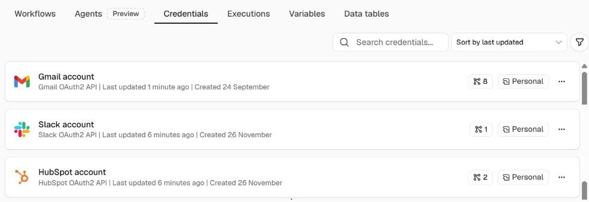

# AI Automation Avanzado — Proyecto integrador

Curso AI Automation Avanzado (Coderhouse) · Jose Ortiz de Zevallos

Copiloto de Estrategia y Gestión de Personas para una empresa productora de alimentos (prototipo con datos ficticios). El mismo proyecto crece en cada pre-entrega.

## Pre-entrega 4: Integraciones reales (CRM, correo y canal del equipo)

**Archivo:** [`checkpoint4_jose_ortiz_de_zevallos.json`](checkpoint4_jose_ortiz_de_zevallos.json), workflow exportado de n8n. Parte del Manager de la pre-entrega 3 y le suma una entrada por correo y tres herramientas conectadas por OAuth2: HubSpot (CRM), Gmail (correo) y Slack (canal del equipo).

**Credenciales activas en n8n:**



Ahora los líderes también pueden reportar su avance por correo. El Copiloto lo procesa igual que un mensaje de chat, deja el contacto al día en el CRM, prepara la respuesta como borrador para que una persona la revise y avisa al canal del equipo.

```
[Gmail Trigger: no leídos con "check-in" o "avance"] → ① [IF ¿respuesta automática?] ── sí → ignorar (corta el bucle)
                                                          └─ no → [Set: entrada desde correo] ─┐
[Chat Trigger] ────────────────────────────────────────────────────────────────────────────────┴→ [Entrada unificada]
→ [Memoria + Router + Workers de la pre-entrega 3] → [¿Llegó por correo?] ── no → respuesta en el chat
   └─ sí → ④ [Set: limpiar y validar payload] → [¿Payload válido?] ── no → descartar (evita el 400)
      └─ sí → ② [HubSpot: buscar por email] → [¿Existe?] ── sí → actualizar nota del contacto
                                                        └─ no → crear contacto (cargo "por validar")
         → ③ [Gmail: crear borrador en el mismo hilo] → [Set: texto mínimo] → [Slack: aviso al canal]
```

- **① Filtro anti respuestas automáticas:** IF inmediatamente después del trigger. Descarta asuntos como *Auto-reply*, *Out of office*, *Respuesta automática*, *Undeliverable* o *Delivery Status Notification*, remitentes `no-reply@`, `noreply@` o `mailer-daemon@`, y correos con las cabeceras `Auto-Submitted` o `Precedence: bulk`. También ignora los logs del propio Copiloto (asunto `[M…]`), así no se responde a sí mismo.
- **Limpieza del correo entrante:** antes de pasar el texto al agente se corta la parte citada del hilo ("El … escribió:", líneas con `>`) y se limita el largo, para no gastar tokens en historial repetido.
- **④ Validación del payload:** un Set arma solo los campos que usan las integraciones (`email`, `nombre`, `asunto`, `texto`, `respuesta`, `estado`) y calcula `email_valido` (formato de correo y respuesta no vacía). Si falla, el ítem se descarta antes de llamar a HubSpot o Gmail, lo que evita errores 400.
- **② Look up antes de Create:** HubSpot busca el contacto por email. Si existe, solo se actualiza la nota con el último check-in; si no, se crea con el cargo "Líder de Personas (por validar)". Así no hay duplicados ni errores 409.
- **③ Human in the loop:** la salida en Gmail es solo **Create Draft**, en el mismo hilo del correo recibido. El Copiloto nunca envía: una persona revisa y aprueba el borrador.
- **Slack liviano:** un Set deja un único campo de texto (líder, asunto, resultado y un resumen de máximo 280 caracteres) antes del nodo de Slack: sin adjuntos ni payloads pesados. Si el KR queda en rojo o pasa a revisión humana, el mensaje parte con `*ALERTA*`. Si Slack falla, el flujo no se corta.

**Permisos mínimos (mínimo privilegio):** son los scopes que necesita el flujo; al crear las credenciales no conviene dar más.

| Herramienta | Credencial n8n | Scopes que usa el flujo |
|---|---|---|
| HubSpot | HubSpot OAuth2 API | `crm.objects.contacts.read`, `crm.objects.contacts.write` |
| Gmail | Gmail OAuth2 API | `gmail.readonly` (leer el correo entrante), `gmail.compose` (crear borradores y enviar el log de trazabilidad) |
| Slack | Slack OAuth2 API | `chat:write`, `channels:read` |

**Prueba de regresión manual (n8n, nodo por nodo):** en los casos de correo, el disparador de Gmail se alimentó con un correo de ejemplo fijado (*pin data*); el resto de los nodos corrió contra HubSpot, Gmail y Slack reales con líderes ficticios (`@example.com`).

| Caso | Resultado |
|---|---|
| Respuesta automática ("Auto-reply") | Se corta en ①; no llega al agente ni a las integraciones |
| Check-in por chat | Recorre la memoria y el Router como en la pre-entrega 3 y responde en el chat |
| Correo de un líder que ya está en el CRM | Look up lo encuentra → actualiza la nota → borrador en Gmail → aviso en Slack |
| Correo de un líder nuevo con un KR en rojo | Look up no lo encuentra → lo crea con cargo "por validar" → borrador → aviso en Slack con `*ALERTA*` |
| Correo sin remitente válido | `email_valido = false` → se descarta antes de HubSpot y Gmail |

**Para importarlo:** además de lo indicado en la pre-entrega 3, asignar las credenciales de Gmail (trigger, borrador y log), HubSpot (los tres nodos del CRM) y Slack, y en el nodo de Slack elegir el canal del equipo (por defecto `copiloto-personas`). El Gmail Trigger revisa cada minuto los correos no leídos de la bandeja de entrada con "check-in", "checkin" o "avance" en el asunto.

## Pre-entrega 3: Memoria persistente y resumen automático

**Archivos (exportados de n8n):**
- [`manager_modulo3_ortiz_de_zevallos_jose.json`](manager_modulo3_ortiz_de_zevallos_jose.json): Manager de la pre-entrega 2 con la capa de memoria.
- [`worker1_modulo3_ortiz_de_zevallos_jose.json`](worker1_modulo3_ortiz_de_zevallos_jose.json): Worker 1 actualizado; recibe el contexto de memoria y entiende lenguaje cotidiano. El Worker 2 no cambia.

```
[Chat Trigger] → [Airtable: buscar por Session_ID] → [IF ¿usuario con memoria?]
   ├─ sí → [Set: user_name, status, last_summary]
   └─ no → [Airtable: crear fila] → [Set: valores neutros]
→ [Router + Workers de la pre-entrega 2, con el contexto entre delimitadores]
→ [Set: preparar memoria] → [Airtable: upsert por Session_ID] → [IF ¿más de 5 mensajes?]
   └─ sí → [Modelo mini: JSON {asunto_principal, puntos_clave, accion_requerida}] → [Set: validar JSON] → [Airtable: upsert del resumen]
→ [Log Gmail] → [Respuesta]
```

- **Base de memoria (Airtable, tabla `Memoria Usuarios`):** una fila por `Session_ID`, con los campos Nombre del usuario, Fecha de actualización, Resumen consolidado, Estado del caso, Datos clave, Última intención, Cantidad de mensajes e Historial reciente.
- **Aislamiento de sesión:** la búsqueda usa `filterByFormula` sobre `Session_ID` justo después del trigger; todas las escrituras son upsert sobre ese mismo campo (idempotentes, sin filas duplicadas).
- **Inyección de contexto:** `user_name`, `status` y `last_summary` entran al System Prompt del agente entre `[INICIO DE CONTEXTO COMPARTIDO]` y `[FIN DEL CONTEXTO COMPARTIDO]`, como dato y no como instrucción.
- **Resumen:** al superar 5 mensajes, un modelo económico condensa el historial con un prompt estricto; un nodo Set valida el JSON antes de escribirlo y el búfer vuelve a 0. Solo se guardan hechos accionables: nada de conversación completa, logs ni HTML.
- **Prueba:** usuario nuevo, usuario recurrente con referencias al contexto, activación del resumen, recuperación desde la memoria consolidada y aislamiento entre tres sesiones.

**Ajuste de experiencia de usuario (posterior a la entrega):**
- **Lenguaje cotidiano:** el líder no necesita saber el código del KR. El Worker 1 lo deduce por sinónimos ("renuncias" = rotación), por la unidad que se desprende de su cargo y por si el valor tiene sentido para ese KR. Si dos KR calzan, pregunta con opciones numeradas; si lo deduce, lo dice como supuesto.
- **Menos fricción:** si no se indica fecha de corte se usa la de hoy; una respuesta a la pregunta del Copiloto ("la de los sucesores") completa el check-in pendiente, y una corrección ("no, eran los días de vacantes") registra el KR correcto reutilizando el valor.
- **Respuestas sin jerga:** el KR se nombra en palabras, el semáforo se explica ("está en riesgo", "requiere atención") y se cierra con un próximo paso concreto. El saludo muestra un menú con ejemplos.
- **Contexto reciente:** el Router y el Worker 1 reciben también los últimos mensajes de la sesión, para entender respuestas cortas.
- **Guardrail determinista:** si el agente afirma haber registrado un avance sin llamar a la herramienta de registro, el contrato de salida reemplaza la respuesta por un aviso y marca una alerta en la traza.
- **Modelos (vía OpenRouter):** Worker 1 con `openai/gpt-5.6-terra` (razonamiento medio); Router y resumidor con `openai/gpt-5.6-luna` (razonamiento bajo).

**Para importarlos:** crear en Airtable la tabla con esos campos, reemplazar `PEGA_AQUI_EL_ID_DE_TU_BASE_AIRTABLE` y `PEGA_AQUI_EL_ID_DE_LA_TABLA_MEMORIA`, y asignar la credencial "Airtable Personal Access Token" (scopes `data.records:read`, `data.records:write`, `schema.bases:read`) y una credencial de OpenRouter en los tres nodos de modelo. El resto de los placeholders son los mismos de la pre-entrega 2.

## Pre-entrega 2: Orquestación multi-agente con sub-workflows

**Archivos (exportados de n8n):**
- [`manager_modulo2_ortiz_de_zevallos_jose.json`](manager_modulo2_ortiz_de_zevallos_jose.json): Workflow Manager.
- [`worker1_modulo2_ortiz_de_zevallos_jose.json`](worker1_modulo2_ortiz_de_zevallos_jose.json): Worker 1 · Check-in OKR.
- [`worker2_modulo2_ortiz_de_zevallos_jose.json`](worker2_modulo2_ortiz_de_zevallos_jose.json): Worker 2 · Indicadores de Personas.

El agente de la pre-entrega 1 se encapsuló como especialista y se agregó un Manager que interpreta la intención y delega (patrón Manager-Worker).

```
[Chat Trigger] → [Router: LLM + JSON estructurado] → [Switch por intención]
   ├─ CHECKIN_OKR          → [Set payload] → [Execute Workflow → Worker 1 · Check-in OKR]
   ├─ INDICADORES_PERSONAS → [Set payload] → [Execute Workflow → Worker 2 · Indicadores]
   ├─ FUERA_DE_ALCANCE     → respuesta de alcance
   └─ fallback (REVISION_HUMANA, confianza < 0,6 o falla del Router) → supervisor humano
[IF status = success] → integrar respuesta | contingencia → [Log Gmail] → [Respuesta]
```

- **Router:** Basic LLM Chain con taxonomía cerrada y Structured Output Parser; devuelve `{intencion, confianza, unidad, mes, indicador, motivo}`. Un Switch determinista decide el destino.
- **Workers:** dos sub-workflows separados, cada uno con Execute Workflow Trigger y una tarea atómica. El Worker 2 no usa LLM.
- **Handoff:** un Set limpia el payload antes de cada Execute Workflow, con *Wait for child to finish* activado. Timeouts: Manager 180 s, Worker 1 120 s, Worker 2 30 s.
- **Contrato de salida:** todo Worker devuelve `{"status": "success" | "error", "worker", "entrada", "data"}`. Ante fallos devuelve un código (`SIN_DATOS`, `ERROR_FUENTE`, `ERROR_AGENTE`, `LIMITE_ITERACIONES`) en vez de cortar la ejecución; si el sub-workflow no responde, la salida de error del Execute Workflow arma el mismo contrato.
- **Trazabilidad:** correo final con intención, Worker invocado, parámetros enviados y respuesta devuelta, sin credenciales ni trazas técnicas.
- **Prueba:** 8 casos ejecutados en n8n (check-in, indicadores, revisión humana, fuera de alcance, mes sin datos, Worker inexistente, fuente caída y consulta de todas las unidades).

**Para importarlos:** importar primero los dos Workers, copiar sus IDs en los nodos `Delegar a Worker 1` y `Delegar a Worker 2` del Manager (`PEGA_AQUI_EL_ID_DEL_WORKER_1` y `_2`), reemplazar `PEGA_AQUI_EL_ID_DE_TU_PLANILLA` (pestañas `OKR_Tracker`, `Checkins` e `Indicadores`) y `TU_CORREO@ejemplo.com`, y asignar las credenciales de OpenAI, Google Sheets y Gmail.

## Pre-entrega 1: Agente autónomo básico funcional

**Archivo:** [`checkpoint1_jose_ortiz_de_zevallos.json`](checkpoint1_jose_ortiz_de_zevallos.json), workflow exportado de n8n.

Asistente de seguimiento estratégico para la Gerencia de Personas de una empresa productora de alimentos (prototipo con datos ficticios). Un líder reporta por chat el avance de un Key Result; el agente consulta el tracker OKR, calcula avance y semáforo, registra el check-in y escala los KR en rojo.

```
[Chat Trigger] → [AI Agent · Tools Agent · máx. 7 iteraciones] → [Log observabilidad (Gmail)] → [Respuesta]
                    ↑ OpenAI Chat Model
                    ↑ Tool: consultar_estado_okr  (Google Sheets, solo lectura)
                    ↑ Tool: registrar_checkin_kr  (Google Sheets, agregar fila)
```

- **Trigger:** Chat Trigger.
- **AI Agent:** modo Tools Agent, `Max Iterations = 7`, System Prompt modular (Rol → Ámbito → Objetivo → Reglas → Escalamiento).
- **Herramientas:** 2 nodos de Google Sheets conectados lateralmente al agente, cada uno con descripción semántica de cuándo usarlo.
- **Observabilidad:** nodo final de Gmail con el estado "Tarea completada" y el Execution Log (herramientas llamadas, entrada y resultado). La salida de error del agente envía una alerta.
- **Prueba:** ejecutado manualmente en n8n con 6 casos (check-ins en rojo, amarillo y verde; consulta general; pedido de cambio de meta; pedido de datos individuales).

**Modelo:** gpt-5-mini. Los créditos gratuitos de OpenAI incluidos en n8n Cloud no permiten gpt-4o; con una API key propia se puede seleccionar gpt-4o en el nodo `OpenAI Chat Model`.

**Para importarlo:** reemplazar `PEGA_AQUI_EL_ID_DE_TU_PLANILLA` (Google Sheet con las pestañas `OKR_Tracker` y `Checkins`) y `TU_CORREO@ejemplo.com`, y asignar las credenciales de OpenAI, Google Sheets y Gmail.
